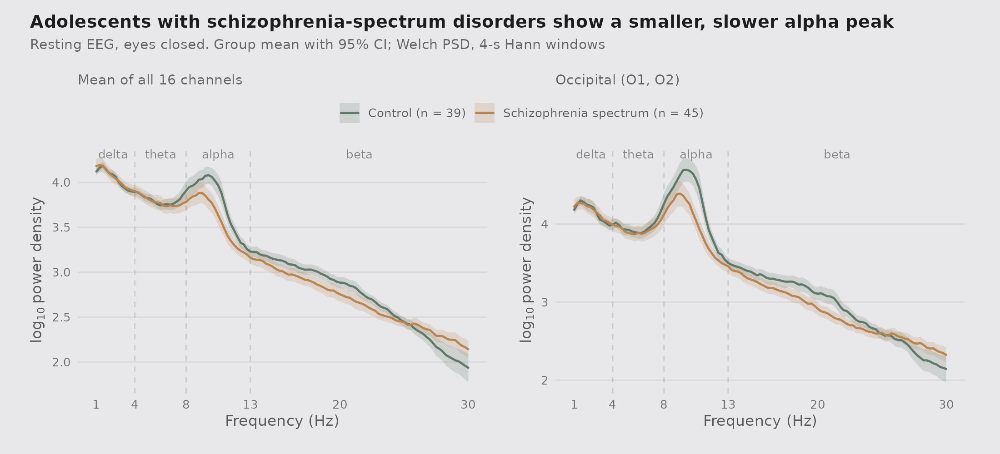
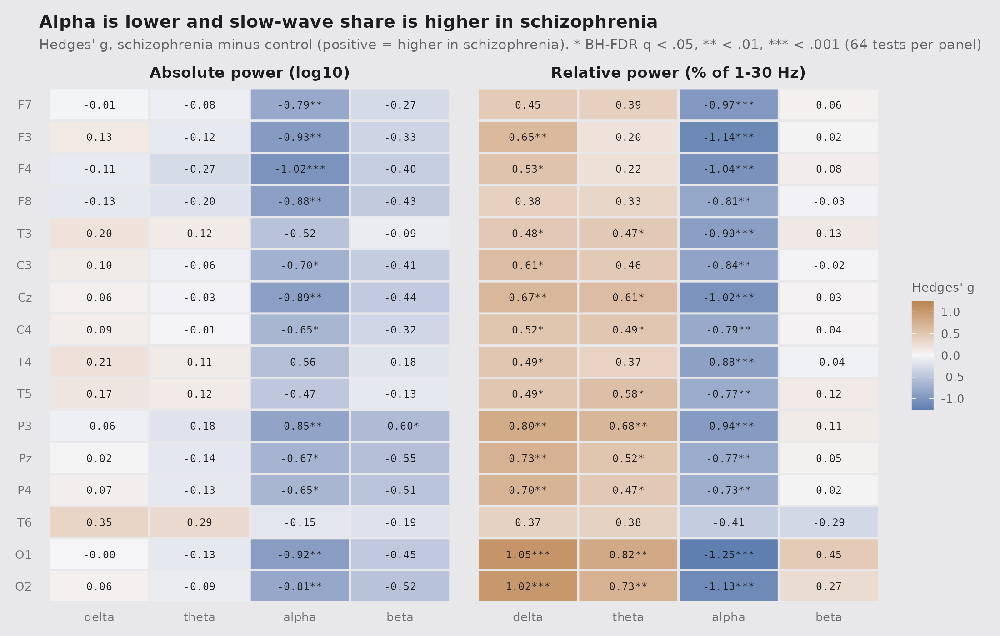
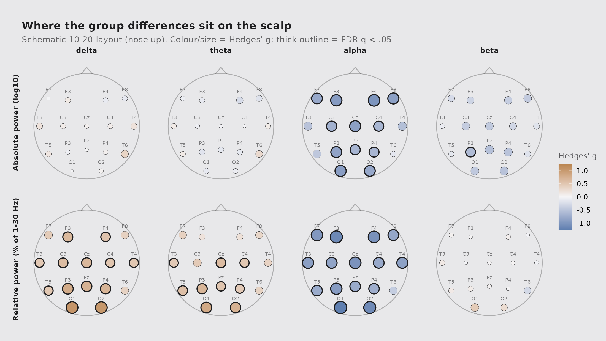
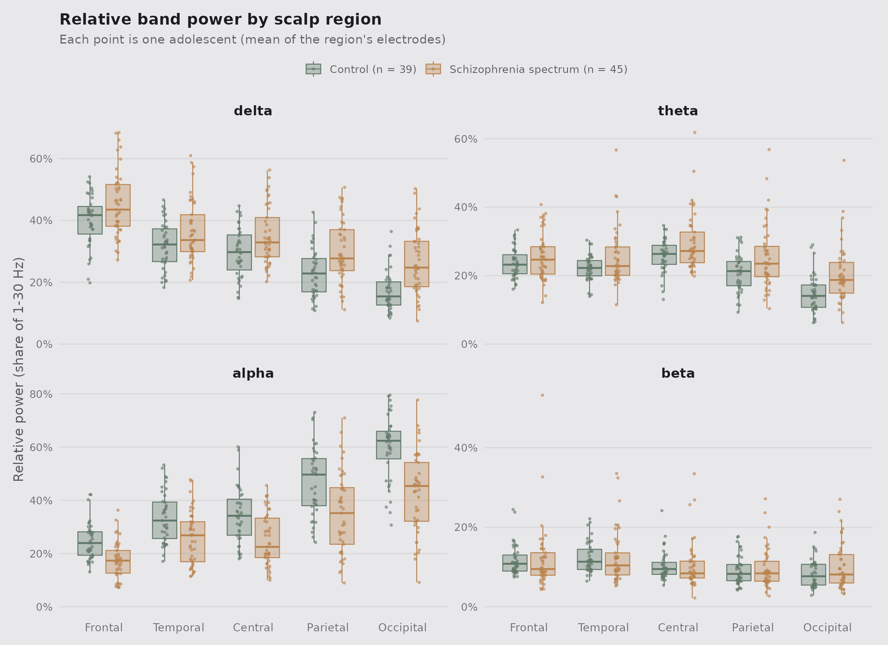
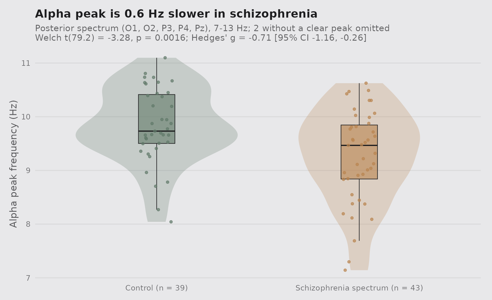
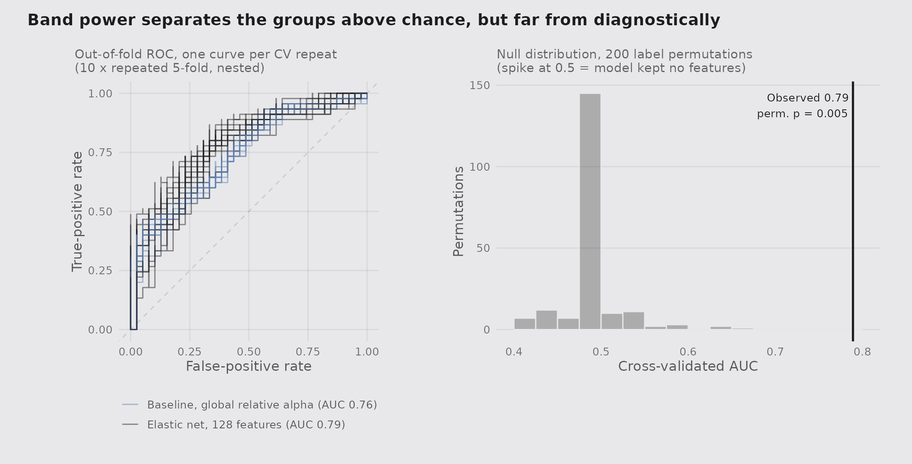

# Resting EEG band power in adolescent schizophrenia

An end-to-end, reproducible R analysis of a small public resting-state EEG dataset:
raw signal → quality control → Welch spectra → band-power features → group statistics with
effect sizes → mixed models → a cross-validated classifier, with every figure built in ggplot2.

**Full report:** [`report/eeg_band_power_report.md`](report/eeg_band_power_report.md)
(also as a self-contained [HTML file](report/eeg_band_power_report.html)).

## Summary

In 84 unmedicated adolescent boys (39 healthy, 45 with schizophrenia-spectrum disorders), the
schizophrenia group had a **weaker and slower alpha rhythm** at rest: lower relative alpha at
15 of 16 electrodes (largest at O1, Hedges' g = −1.25), roughly 45–60% of control absolute alpha
power over occipital and frontal regions, and a 0.6 Hz slower alpha peak (g = −0.71). Absolute
delta and theta power did not differ. An elastic-net classifier on 128 band-power features
separated the groups above chance (nested-CV AUC 0.79, permutation p = 0.005), but only slightly
better than a single feature, global relative alpha (AUC 0.76).

## Question

Does resting, eyes-closed EEG spectral power differ between adolescents with
schizophrenia-spectrum disorders and healthy adolescents? In which frequency bands, where on the
scalp, how large are the effects, and how well do they separate the groups out of sample?

## Data

**MSU EEG database: healthy adolescents and adolescents with symptoms of schizophrenia.**
Laboratory for Neurophysiology and Neuro-Computer Interfaces, M.V. Lomonosov Moscow State University.
<http://brain.bio.msu.ru/eeg_schizophrenia.htm>

- 39 healthy schoolboys and 45 boys with schizophrenia-spectrum diagnoses (ICD-10 F20, F21, F25),
  ages about 11–14 (mean 12.3 in both groups), not receiving medication at examination.
- 60 s of wakeful, eyes-closed EEG; 16 electrodes (F7, F3, F4, F8, T3, C3, Cz, C4, T4, T5, P3, Pz,
  P4, T6, O1, O2), linked-ear reference, 128 Hz, supplied as artefact-free records.
- Two zip files, ~16 MB in total. **No data are committed to this repository**;
  `R/00_download_data.R` fetches them and checks their MD5 sums.

**Citation:** Borisov SV, Kaplan AYa, Gorbachevskaya NL, Kozlova IA (2005). Analysis of EEG
structural synchrony in adolescents with schizophrenic disorders. *Human Physiology* 31(3):255–261.
<https://doi.org/10.1007/s10747-005-0042-z>

**Licence:** the source page makes the data freely downloadable for research but states no
explicit licence. For that reason the data are not redistributed here; please cite the authors
above when using them. The MIT licence in this repository covers the code only.

## Methods

| Step | What was done | Script |
|---|---|---|
| Download | Fetch both archives, verify MD5, unzip | `R/00_download_data.R` |
| Cleaning / QC | Mean-centre channels; check for missing values and flat channels; split into 29 overlapping 4-s segments and reject any segment where a channel's peak-to-peak amplitude exceeds its within-subject median + 5 MAD; flag channels with outlying variance (robust z > 3.5); pre-specified exclusion if > 25% of segments are rejected | `R/01_preprocess.R` |
| Spectra | Welch PSD per channel: 4-s Hann windows, 50% overlap, linear detrend, 0.25 Hz resolution (implemented in base R) | `R/01_preprocess.R`, `R/utils.R` |
| Features | Delta 1–4, theta 4–8, alpha 8–13, beta 13–30 Hz as log10 absolute power and relative power (share of 1–30 Hz); individual alpha peak frequency from the posterior spectrum | `R/02_features.R` |
| Group statistics | Per channel × band: Welch t-test, Wilcoxon rank-sum as a robustness check, Hedges' g with 95% CI, Benjamini–Hochberg FDR over 64 tests per measure. Region-level linear mixed models per band: `log10 power ~ group * region + (1 \| subject)` (`lmerTest`, Type III, Satterthwaite df) | `R/03_group_stats.R` |
| Classifier | Elastic-net logistic regression (`glmnet`, α = 0.5) on 128 features, lambda tuned by inner 5-fold CV inside each outer fold (nested), evaluated with 10 × repeated stratified 5-fold CV; one-feature logistic baseline; 200-permutation test of the whole pipeline | `R/04_classifier.R` |
| Figures / report | ggplot2 + patchwork figures; R Markdown report rendered to GitHub markdown and HTML | `R/05_figures.R`, `report/` |

QC outcome: no missing or flat channels; median 0 (max 4) of 29 segments rejected per subject;
no subject excluded; 7 channel recordings (from 2 subjects) had outlying variance and were kept.

## Key findings

**1. The alpha peak is smaller and shifted lower in schizophrenia; slow-wave power is similar.**



**2. Alpha effects are large and widespread; relative delta/theta rise mainly because alpha falls.**
Absolute alpha was lower at 12/16 channels and relative alpha at 15/16 (FDR q < .05). No channel
showed an absolute delta or theta difference (all |g| < 0.36). The higher *relative* delta and
theta in schizophrenia (13 and 9 channels) therefore mainly reflects the smaller alpha share,
and fewer of those channels survive the rank-based test (7 and 4).





**3. Region-level mixed models agree.** Only alpha has a main effect of group after FDR
(F(1, 82) = 15.3, p = 1.9 × 10⁻⁴); group × region interactions show the difference is not uniform
over the scalp, with the largest alpha reductions over occipital (power ratio 0.46) and frontal
(0.59) regions.



**4. Alpha peak frequency is slower:** 9.26 vs 9.83 Hz, Welch t(79.2) = −3.28, p = 0.002,
g = −0.71 [−1.16, −0.26] (2 patients with no identifiable peak omitted).



**5. Above chance, but not diagnostic.** Nested-CV AUC 0.79 (range 0.72–0.83 over repeats;
balanced accuracy 0.71) versus a permutation-null 95th percentile of 0.55. The single-feature
baseline (global relative alpha) reaches AUC 0.76, so most of the signal is one alpha effect.
The most consistently selected features were relative alpha at O1, O2 and F3.



### Limitations

Small, single-site, all-male sample; no per-subject age, IQ or symptom scores, so age (which
strongly affects alpha frequency in adolescence) can't be modelled directly beyond the authors'
group matching. Only 60 s per subject, pre-cleaned by the providers. The file amplitude scale is
larger than typical microvolt EEG, so absolute power is read on a log scale as a between-group
contrast; relative power and peak frequency don't depend on gain. The near-absence of 50 Hz
energy suggests the data were low-pass filtered before release, so the analysis stays within 1–30 Hz.

## How to reproduce

Requirements: R ≥ 4.2 and pandoc (bundled with RStudio) for the report.

```bash
git clone https://github.com/humbleambition/eeg-band-power-analysis.git && cd eeg-band-power-analysis
Rscript R/install_packages.R      # dplyr, tidyr, readr, purrr, ggplot2, patchwork,
                                  # lme4, lmerTest, glmnet, pROC, rmarkdown, knitr
Rscript run_all.R                 # download (~16 MB) -> QC -> features -> stats ->
                                  # classifier -> figures -> report  (~2-3 min)
```

Run each step on its own with `Rscript R/0X_*.R` from the project root. Random seeds are fixed,
so the CV and permutation results reproduce exactly on the same package versions
(see `results/sessionInfo.txt`).

```
eeg-band-power-analysis/
├── R/                  analysis scripts (00-05), utils.R, install_packages.R
├── data/               created by the download script; git-ignored
├── figures/            PNG figures used in this README and the report
├── report/             R Markdown source + rendered .md and .html
├── results/            CSV outputs: QC, band power, statistics, classifier, sessionInfo
├── run_all.R
├── LICENSE             MIT (code only)
└── README.md
```

## Author

Jennifer Hsieh, PhD (neuroscience). My doctoral work used resting EEG to compare
methamphetamine-associated psychosis, schizophrenia and healthy controls; this project uses
the same toolkit on an open adolescent dataset.
